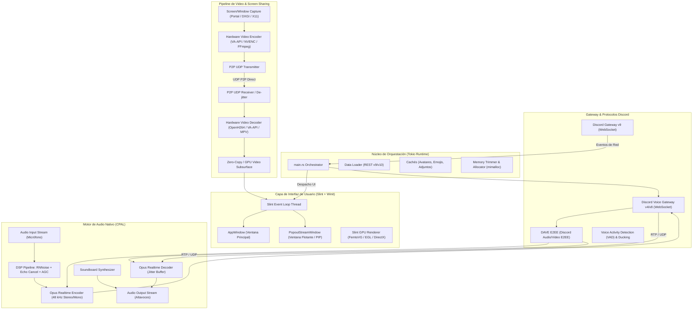
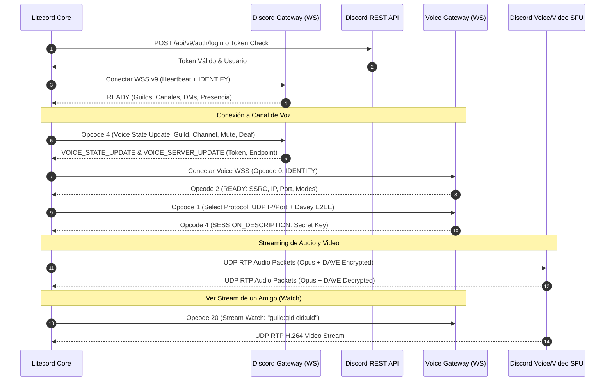
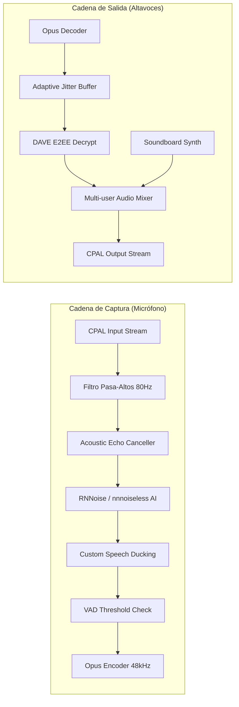
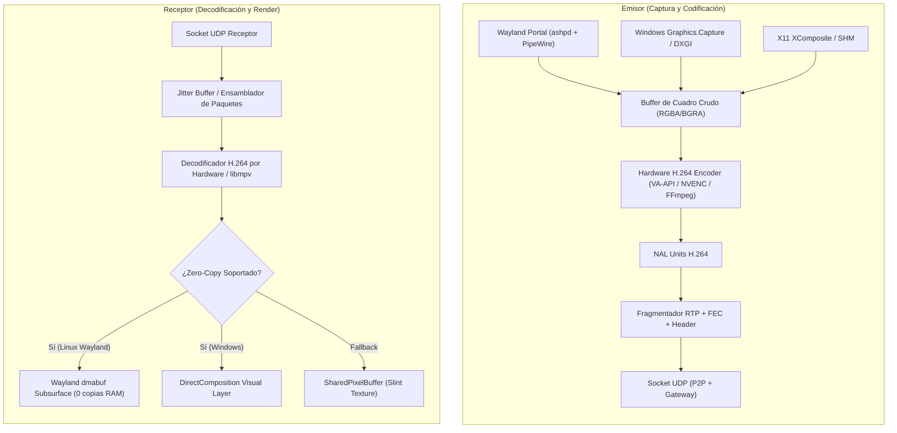
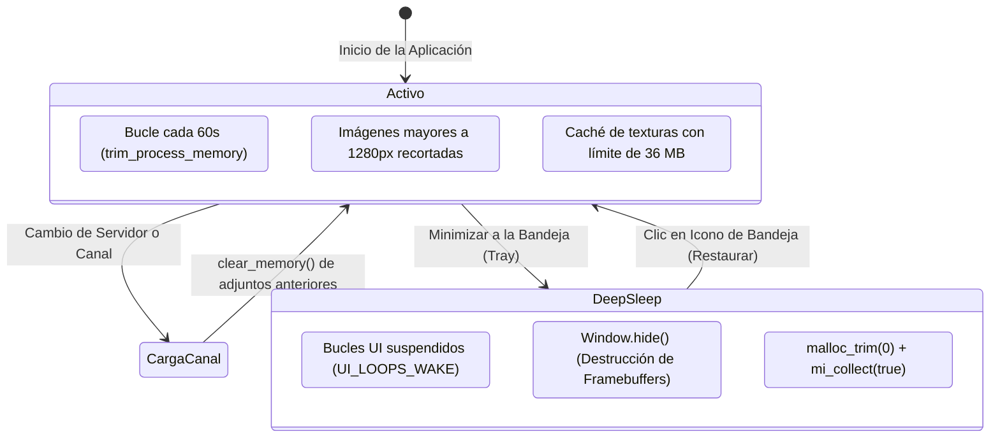

# 📐 Arquitectura Integral de Litecord

**Versión del Sistema:** v1.3.0-beta  
**Tecnología Central:** Rust 2021 + Slint UI Toolkit (Renderer GPU) + Tokio Async Runtime + CPAL / DSP + WebRTC / P2P UDP  
**Filosofía:** Cliente nativo de Discord de ultra-alto rendimiento, huella de memoria mínima (~150-180 MB RSS), cero consumo en reposo (DeepSleep) y procesamiento multimedia en tiempo real sin latencia.

---

## 1. Visión General de la Arquitectura

Litecord desacopla el cliente en **cinco subsistemas asíncronos concurrentes** que se comunican mediante canales MPSC sin bloqueos (*lock-free queues / crossbeam / tokio*) y variables de estado atómicas:

---

## 2. Desglose de Módulos

### 2.1. Capa de Presentación (`src/ui/` y `ui/*.slint`)

* **Framework Gráfico:** [Slint 1.17.1](https://slint.dev/) compilado con backend nativo Winit y aceleración por GPU (FemtoVG sobre OpenGL / EGL en Linux, DirectComposition en Windows).
* **`AppWindow`:** Ventana principal sin bordes (*frameless*) con controles personalizados de redimensionado, minimizado, arrastre (`drag_window`) y soporte para temas claro, oscuro y dinámico.
* **`PopoutStreamWindow` (Ventana Flotante / PIP):**
  - **Instanciación Perezosa (*Lazy Lifecycle*):** Se crea bajo demanda exclusivamente cuando el usuario expulsa un stream. Esto previene la duplicación de iconos en barras de tareas como KDE Plasma (`groupingStrategy=0`).
  - **Modo Intangible (*Ghost Mode*):** Permite atravesar clicks (`set_cursor_hittest(false)` y `WS_EX_TRANSPARENT`) para superponer la transmisión sobre videojuegos sin interferir en los controles.
  - **Auto-Hide:** Oculta controles de reproducción tras 3 segundos de inactividad del cursor.
* **Componentes Slint Clave:**
  - `chat_messages_view.slint`: Renderizado reactivo de mensajes, embeds, banners de juegos, botones interactivos y adjuntos con scroll virtual.
  - `channel_sidebar.slint`: Árbol jerárquico de categorías y canales (texto, voz, foros, hilos).
  - `voice_room_view.slint`: Grilla reactiva de participantes en llamada con animaciones de nivel de voz (VU meter) en tiempo real y selector de calidad de streaming.
  - `EmojiRow` y `SoundboardRow`: Modelos lineales que evitan anidamientos `for/if` de Slint para eliminar *phantom nodes* y desbordamientos.

---

### 2.2. Gateway y Protocolo de Discord (`src/gateway/`)

* **`client.rs` (Gateway v9):**
  - Manejo de sesión persistente con reconexión automática y reanudación (*RESUME* con `session_id` y `seq_num`).
  - Despacho de eventos tipados hacia la UI mediante el canal `event_tx: mpsc::Sender<GatewayEvent>`.
  - Detección de estados de voz globales (`VoiceStatesUpdated`) y sincronización reactiva de participantes.
* **`voice.rs` (Voice Gateway v4/v8):**
  - Negociación de socket UDP para transporte de audio y señalización de streaming.
  - **Soporte DAVE (Discord Audio/Video E2EE):** Integración con la biblioteca `davey` para encriptación de extremo a extremo en canales compatibles con el nuevo protocolo de seguridad de Discord.
  - **Opcode 20 (`Stream Watch`):** Activación explícita para que el servidor SFU de Discord dirija los paquetes de vídeo del usuario transmitiendo hacia nuestro socket de recepción.
* **Cambio Instantáneo de Servidores (Zero-Network Server Switching) y Caché de Permisos:**
  - En lugar de bloquear la interfaz ejecutando 4 peticiones HTTP secuenciales al hacer clic en un servidor (`/channels`, `/users/@me`, `/guilds`, `/members`), Litecord extrae el árbol completo de canales directamente del payload del evento `READY` y eventos `GUILD_CREATE` del Gateway, rellenando `guilds_map`.
  - En `app.on_select_guild`, los canales del servidor seleccionado se renderizan inmediatamente en el hilo principal de Slint en **0.0 milisegundos**, sin esperar respuesta de red.
  - La verificación REST y el cálculo de permisos se ejecutan concurrentemente en segundo plano con `tokio::join!`. Las consultas de permisos se almacenan en una caché de 5 minutos (`PERMISSIONS_CACHE`), reutilizando el `user_id` en memoria para eliminar llamadas redundantes a `/users/@me`.

---

### 2.3. Pipeline de Audio y DSP en Tiempo Real (`src/audio/`)

El pipeline de audio de Litecord opera a una tasa fija de **48.000 Hz, 16-bit / f32, estéreo/mono**, optimizado para latencias inferiores a **10 ms**.

* **Supresión de Ruido Neural:** Implementado con redes neuronales recurrentes (`nnnoiseless` / RNNoise) que eliminan teclado mecánico, ventiladores y ruido ambiente con consumo de CPU despreciable (<0.5%).
* **Cancelación de Eco Acústico (AEC) con Loopback de Referencia:**
  - **Buffer Circular Lock-Free SPSC (`LockFreeAudioRingBuffer`):** Cola atómica de 65.536 muestras (~1,365 s a 48 kHz) respaldada por un array de `AtomicU32` (almacenando los bits de las muestras `f32`), libre de locks (`Mutex`) y de asignaciones dinámicas en el heap.
  - **Alineación a Línea de Caché (`#[repr(align(64))]`):** Los índices `write_idx` y `read_idx` están envueltos en `CachePaddedAtomicUsize` alineados a 64 bytes para eliminar el *false sharing* e invalidaciones continuas de caché L1/L2 entre los hilos de reproducción y captura de CPAL.
  - **Mecanismo Anti-Drift (Separación de Umbral y Horizonte de Lectura):** Para evitar que el hilo de captura consuma audio viejo o retenga una cola estacionaria, si la acumulación supera 1.920 muestras (40 ms), `pop_samples()` salta directamente al último bloque necesario (`out.len()`, 960 muestras / 20 ms), dejando 0 muestras residuales tras la lectura y otorgando el máximo margen temporal al filtro LMS.
  - **Alcance Físico del Micro-Filtro LMS y Latencia del SO:**
    - El filtro transversal en el código actual opera con 48 taps adaptativos (1,0 ms a 48 kHz) y una línea de retardo de 1.024 muestras (21,3 ms).
    - En sistemas de escritorio reales, la latencia de buffer del servidor de sonido (PipeWire, PulseAudio, WASAPI) más la conversión D/A y A/D introduce entre 20 y 50 ms (960 a 2.400 muestras) de retardo total. Con PipeWire en baja latencia (quantum 256/512 muestras = 5,3 a 10,6 ms), la señal entra en la ventana de análisis; en servidores estándar de 20ms+20ms, la supera.
    - Se clasifica formalmente como un micro-filtro de diafonía de campo cercano (acoplamiento eléctrico o fuga directa cápsula-auricular), dejando la cancelación acústica de sala completa con altavoces en la hoja de ruta para migración a un filtro adaptativo en el dominio de la frecuencia por bloques (FDAF / MDF, como SpeexDSP) o WebRTC AEC3.
  - Resampleador de fase fraccional (`PhaseResampler`) para mitigar derivas de reloj (*clock drift*) cuando el micrófono y los altavoces funcionan en dispositivos de hardware independientes.
* **Speech Ducking Automático:** Si el usuario habla mientras escucha música o a otros participantes con volumen alto, el cliente atenúa suavemente los canales secundarios para maximizar la inteligibilidad del diálogo.
* **Soundboard Integrado:** Sintetizador de efectos procedurales y decodificador de archivos PCM/WAV en tiempo real que inyecta clips en la mezcla de audio sin retardos de lectura en disco.

---

### 2.4. Subsistema de Video y Transmisión de Pantalla (`src/screen_capture/`)

Litecord implementa una arquitectura híbrida de transmisión de pantalla P2P directa combinada con integración nativa con Discord Voice Gateway.

#### Estrategia Zero-Copy y Eficiencia Extrema:
1. **Linux (Wayland):**
   - Captura por `PipeWire` a través de XDG Desktop Portal.
   - En reproducción, desacopla la decodificación hacia `libmpv` con soporte de búferes `dmabuf` directos al compositor (KWin / Mutter) mediante subsuperficies de Wayland (`wl_subsurface`).
   - **Sincronización Atómica de Subsuperficies:** Se configura `wl_subsurface.set_sync` durante eventos de redimensionado y scroll para que los límites del viewport de video se apliquen de forma atómica en el mismo commit que la superficie principal de Slint, eliminando el retraso de 1 fotograma (*floating video lag*) y evitando desbordamientos de geometría.
   - **Resultado:** 0 copias en CPU y 0 MB de texturas en memoria RAM principal.
2. **Windows:**
   - Captura directa por hardware mediante `Windows.Graphics.Capture` (Direct3D11).
   - Renderizado del reproductor enlazado a capas de composición aceleradas por DirectX (`DirectComposition`).

---

## 3. Modelo de Concurrencia y Subprocesos

Litecord evita cuellos de botella en la interfaz gráfica ejecutando cada operación intensiva en su propio contexto de ejecución especializado:

| Hilo / Runtime | Prioridad | Función Principal |
| :--- | :--- | :--- |
| **Slint Event Loop (Main Thread)** | Normal (UI) | Manejo de eventos del mouse/teclado, layouting declarativo de Slint, animaciones y renderizado GPU. |
| **Tokio Async Worker Pool (4 hilos)** | Normal | Conexiones WebSocket (Gateway, Voice), llamadas REST a Discord API, descargas concurrentes de imágenes. |
| **CPAL Realtime Audio Input** | Tiempo Real (*High Priority*) | Captura del micrófono a 48 kHz, DSP, cancelación de eco adaptativa y codificación Opus. |
| **CPAL Realtime Audio Output** | Tiempo Real (*High Priority*) | Decodificación Opus de participantes, mezclado en coma flotante y entrega a la tarjeta de sonido. |
| **Rayon Worker Pool (2 hilos)** | Baja / Batch | Descompresión y renderizado de imágenes pesadas y avatares sin bloquear Tokio ni la UI. |
| **Screen Capture & Encoder Thread** | Alta | Grabación de pantalla (30/60 FPS) y codificación H.264 por hardware. |
| **Video Receiver / Player Thread** | Alta | Ensamblaje de paquetes UDP y decodificación de vídeo entrante. |

---

## 4. Gestión de Memoria y Modo DeepSleep

Litecord utiliza el asignador [mimalloc](https://github.com/microsoft/mimalloc) de Microsoft combinado con mecanismos estrictos de compactación y liberación de páginas al kernel:

1. **Configuración Equilibrada de `mimalloc`:**
   - `MI_OPTION_PURGE_DELAY = 30`: Retardo de purga de 30 ms durante el uso activo. Permite reutilizar páginas calientes durante ráfagas de alta rotación (scroll rápido en chat, deserialización de ráfagas JSON del Gateway) sin generar tormentas de *syscalls* (`madvise(MADV_DONTNEED)`) ni *TLB shootdowns* entre núcleos de CPU.
   - `MI_OPTION_RESERVE_HUGE_OS_PAGES = 0`: Desactiva la asignación preventiva de bloques de 30 MB de *Transparent Huge Pages*, reduciendo la huella base.
2. **Caché de Adjuntos por Presupuesto en Bytes con Desalojo LRU (`AttachmentCache`):**
   - **Presupuesto Máximo de 36 MB en RAM:** En lugar de un conteo rígido de ítems, el almacén `MemoryFullStore` monitorea la suma exacta de bytes de los buffers RGBA en memoria. Múltiples miniaturas y stickers livianos pueden coexistir simultáneamente sin provocar expulsiones prematuras (*thrashing*).
   - **Política LRU Estricta:** Al superar los 36 MB, se expulsan progresivamente las texturas menos recientemente accedidas hasta volver a situarse dentro del presupuesto.
   - **Downscaling Preventivo (1280x1280 máx.):** Imágenes en 4K o 1080p se escalan proporcionalmente a un máximo de 1280px antes de cargarse en RAM/GPU, reduciendo el consumo por imagen de ~33 MB a ~2.5 MB sin pérdida perceptual en tarjetas de chat.
   - **Limpieza por Cambio de Canal (`clear_memory`):** Al navegar a un canal diferente, se liberan inmediatamente las texturas del canal previo.
3. **Modo DeepSleep (Minimizado a Tray):**
   - El bucle de dibujo de Slint se congela completamente (`UI_LOOPS_WAKE`).
   - Se libera el Working Set del proceso (`K32EmptyWorkingSet` en Windows y `malloc_trim(0)` + `mi_collect(true)` en Linux), colapsando el consumo de RAM a niveles mínimos (~40-60 MB).

---

### 4.6. Ciclo de Vida de Geometría de Ventana, Semántica de Wayland (`xdg_toplevel`) y Preservación de Estado Flotante (`src/utils/window_state.rs`)

Litecord persiste el estado y dimensiones de la ventana (`WindowState`) en directorios canónicos del sistema operativo (`~/.config/litecord/window_state.json` en Linux y `%APPDATA%/Litecord/window_state.json` en Windows). Sin embargo, el soporte nativo bajo Wayland (KWin / Plasma, GNOME / Mutter) y X11 introduce consideraciones críticas:

1. **Semántica de Wayland (`xdg_toplevel`) sobre la Posición Global `(x, y)`:**
   - En Wayland, por diseño estricto de seguridad del protocolo para evitar *clickjacking* y ataques de superposición (*overlay phishing*), las aplicaciones clientes **tienen prohibido** conocer y fijar sus coordenadas globales en pantalla.
   - En KWin/Wayland, `winit_win.set_outer_position()` es ignorado deliberadamente por el compositor y `outer_position()` retorna `None` o `(0, 0)`. Quien determina la posición, monitor y colocación de la ventana es el propio compositor (KWin) a través de sus políticas de gestión o las "Reglas de Ventana de KDE Plasma".
   - Bajo X11 y Windows (Win32), las coordenadas `(x, y)` sí son persistidas y restauradas fielmente.
2. **Guarda Antirruido de Mapeo Inicial (`WINDOW_PERSISTENCE_READY`):**
   - Al invocar `app.show()`, KWin y Winit emiten eventos transitorios iniciales de `Configure` y `Resized` antes de que el árbol visual de Slint y el compositor estabilicen la geometría. Si el hilo de persistencia reaccionara inmediatamente, sobrescribiría el archivo de estado con las dimensiones mínimas o por defecto (980x620).
   - Litecord introduce una bandera atómica `WINDOW_PERSISTENCE_READY: AtomicBool` combinada con un temporizador `single_shot` de 600 ms tras `set_visible(true)` para descartar ráfagas transitorias de mapeo.
3. **Preservación del Tamaño Flotante ante Ventanas Maximizadas:**
   - **La Trampa Clásica:** Al maximizar una ventana en KWin, el compositor emite un evento `Resized` con la resolución total del monitor (ej. 1920x1080 o 1920x1044). Si la aplicación registra ese ancho y alto en el archivo de estado, cuando el usuario hace clic en "Restaurar" (des-maximizar) o reinicia la app en modo flotante, la ventana olvida su tamaño personalizado (ej. 1100x750) y queda pegada a 1920x1044.
   - **Solución en Litecord:**
     - `update_window_geometry` en `src/utils/window_state.rs` aplica una guarda estricta `if !is_maximized`. Cuando la ventana está maximizada, únicamente se guarda `is_maximized: true`, preservando intactos el último `width` y `height` flotantes.
     - En `src/main.rs`, el listener de `Resized` y los manejadores de cierre combinan `w.is_maximized()` con un heurístico de resolución del monitor (`abs(ancho - monitor_ancho) <= 4` y `abs(alto - monitor_alto) <= 120`) para detectar la maximización instantáneamente, evitando carreras asíncronas en Wayland donde el buffer de tamaño llega antes que el cambio de bandera en Winit.
     - En el arranque, si `is_maximized` es verdadero, Litecord pre-configura primero la ventana con el tamaño flotante guardado antes de llamar a `set_maximized(true)`. De esta forma, el compositor registra el tamaño flotante previo como objetivo de restauración cuando el usuario des-maximiza.

---

## 5. Matriz Multiplataforma

| Componente | Linux (Wayland / X11) | Windows (10 / 11) | macOS |
| :--- | :--- | :--- | :--- |
| **Captura de Pantalla** | XDG Desktop Portal + PipeWire | Windows.Graphics.Capture (D3D11) | ScreenCaptureKit / CoreGraphics |
| **Render de Video PIP** | Wayland Subsurface (`set_sync`) / libmpv | DirectComposition Visual / EGL | Metal / AVPlayerLayer |
| **Audio Loopback** | PulseAudio / PipeWire `pulsesrc` | WASAPI Loopback Capture | CoreAudio Process Tap |
| **Atajos Globales** | XDG Portal `GlobalShortcuts` (`ashpd`) en Wayland; `XGrabKey` en X11; `evdev` como fallback | Windows `RegisterHotKey` / Hooks | CGEventTap / Carbon |
| **Ventana Intangible** | Winit `set_cursor_hittest(false)` | `WS_EX_TRANSPARENT` + `WS_EX_LAYERED` | `ignoresMouseEvents = YES` |
| **Bandeja del Sistema** | Libayatana / SNI (StatusNotifierItem) | Shell_NotifyIconW | NSStatusItem |

