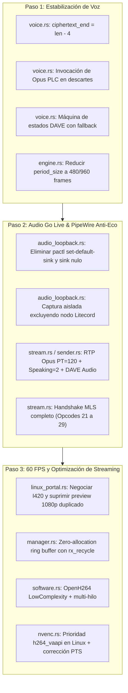

# Auditoría Técnica y Roadmap de Optimización de Litecord

**Fecha de Actualización:** 1 de Noviembre de 2026  
**Entorno:** Linux x86_64 (Wayland / PipeWire / WirePlumber / ALSA)  
**Objetivos Principales:**
1. Eliminar ruidos, artefactos, chasquidos y microcortes al escuchar a otros usuarios en llamadas.
2. Habilitar sonido estéreo nativo en transmisiones de pantalla para Discord Go Live **sin bucles de eco** y **sin romper WirePlumber/PipeWire**.
3. Prevenir regresiones destructivas en el subsistema de audio local (preservar conmutación dinámica de auriculares AUX y perfiles Bluetooth).
4. Solucionar caídas severas de FPS durante la captura de pantalla bajo Wayland/PipeWire manteniendo el presupuesto de memoria (~150 MB en streaming).

---

## 1. Contexto Histórico y Diagnóstico Inicial

### 1.1 Antecedentes Recientes
- **Fallo previo de audio del sistema:** Intervenciones anteriores crearon sinks nulos (`LitecordDesktopSink`) y alteraron el *default sink* mediante `pactl`, provocando que WirePlumber perdiera la conmutación automática hacia auriculares AUX y dejara el sistema de audio mudo o bloqueado.
- **Voz saliente no escuchada por terceros:** Se detectó un error en el cifrado XChaCha20-Poly1305 donde el nonce de 4 bytes se ubicaba erróneamente en `[20..24]` en lugar de `[0..4]` en [voice.rs](file:///home/kes/Litecord/src/gateway/voice.rs). Esto fue corregido en el commit `6e7d743`, restaurando la voz del usuario hacia Discord.
- **Problemas reportados actuales:**
  1. Amigos en la llamada se escuchan con artefactos, chasquidos o ruidos estáticos ocasionales.
  2. Al compartir pantalla en Discord ("Go Live"), los espectadores ven la transmisión con muy bajos FPS y completamente sin sonido.

---

## 2. Hallazgos Técnicos y Correcciones Críticas

### 2.1 Voz Entrante: Criptografía, Opus PLC y DAVE
Ubicación principal: [src/gateway/voice.rs](file:///home/kes/Litecord/src/gateway/voice.rs)

1. **Cálculo incorrecto de padding RTP previo al descifrado AEAD ([voice.rs:648-659](file:///home/kes/Litecord/src/gateway/voice.rs#L648-L659)):**
   - El código lee `let padding_len = if has_padding && len > 5 { pkt[len - 5] as usize } else { 0 };` y resta dicho valor a `ciphertext_end` **antes** de ejecutar el descifrado AEAD (AES-GCM o XChaCha20-Poly1305).
   - En el protocolo de Discord `aead_*_rtpsize`, los últimos 4 bytes del datagrama son el nonce en texto plano y los 16 anteriores son el tag criptográfico. El padding RTP viaja **cifrado dentro del payload**.
   - Al intentar leer `pkt[len - 5]` antes de descifrar, se interpreta un byte pseudoaleatorio del tag como tamaño de relleno, truncando el texto cifrado y provocando fallos de descifrado recurrentes (`Descriptografia AES-GCM falhou...`). Además, el código ya incluye remoción de padding *después* del descifrado en las líneas [921-926](file:///home/kes/Litecord/src/gateway/voice.rs#L921-L926).
   - **Corrección:** Fijar `let ciphertext_end = len - 4;` y dejar que el descarte de padding opere exclusivamente post-descifrado.

2. **Manejo de pérdidas: Invocación obligatoria de Opus PLC en lugar de descarte silencioso ([voice.rs:857-893](file:///home/kes/Litecord/src/gateway/voice.rs#L857-L893)):**
   - *Riesgo identificado:* Si un paquete falla en la verificación AEAD o en el descifrado DAVE y simplemente se descarta con un `continue`, el ring buffer sufre un underrun o discontinuidad de fase que el oído humano percibe como un "clic" o salto seco.
   - *Corrección técnica:* Ante cualquier fallo de descifrado o paquete corrupto descartado, **no hacer descarte silencioso**. Se debe invocar el mecanismo nativo de Packet Loss Concealment (PLC) de `libopus` llamando a `dec.decode(None, &mut pcm_out, false)` por la duración del frame (960 muestras a 48 kHz). Esto sintetiza una transición armónica suave y elimina los chasquidos.

3. **Verificación contextual de DAVE y transiciones de época ([voice.rs:808-842](file:///home/kes/Litecord/src/gateway/voice.rs#L808-L842)):**
   - *Riesgo identificado:* La condición fija `ends_with(&[0xFA, 0xFA])` rompe la compatibilidad durante transiciones de época MLS (entre `DAVE_PREPARE_TRANSITION` Op 21 y `DAVE_EXECUTE_TRANSITION` Op 22) o al recibir audio de bots/clientes sin DAVE que envían Opus estándar sin el Supplemental Data Footer.
   - *Corrección técnica:* Validar el estado de transición del remitente:
     - Si la sesión DAVE está activa y el emisor completó el handshake MLS (época $\ge 1$), se exige la firma `0xFAFA`. Si no la tiene o falla `s.decrypt()`, se dispara Opus PLC.
     - Si la sesión está en ventana de transición/downgrade (Op 24 $\rightarrow$ Op 21), se permite passthrough directo a Opus únicamente si `dave_flow_rx.plaintext_allowed()` o `dave_session.can_passthrough(user_id)` es verdadero.
     - Eliminar definitivamente las llamadas con `swapped_uid` que saturan los logs y bloquean el mutex de la sesión.

4. **Dimensionamiento del Jitter Buffer y Período de ALSA/PipeWire ([voice.rs:26](file:///home/kes/Litecord/src/gateway/voice.rs#L26), [engine.rs:24](file:///home/kes/Litecord/src/audio/engine.rs#L24)):**
   - *Ajuste de latencia y canales:* 3840 muestras equivalen a 80 ms solo en mono. En un búfer estéreo intercalado (2 canales), 80 ms son 7680 muestras (3840 frames). Subir el prebuffer a 80 ms sumado al período de ALSA de 2048 frames (~42.6 ms) genera más de 120 ms de latencia local perceptible en conversación rápida.
   - *Corrección técnica:* El vaciamiento ocurre porque el consumidor pide de golpe 2048 frames. En lugar de inflar el prebuffer, se reduce el `period_size` / `DEFAULT_VOICE_OUT_FRAMES` de ALSA/PipeWire en `engine.rs` a **480 frames (10 ms)** o **960 frames (20 ms)**, manteniendo el prebuffer en **40–60 ms** (1920 a 2880 frames a 48 kHz).
   - En la rama `I16` de [voice.rs:1388](file:///home/kes/Litecord/src/gateway/voice.rs#L1388), unificar el cálculo de umbral dinámico `.max(frames * 3)` e inicializar `resample_hist` con la primera muestra recibida.

---

### 2.2 Transmisión Go Live: Aislamiento de Audio (Anti-Eco) y Protocolo
Ubicaciones: [src/screen_capture/audio_loopback.rs](file:///home/kes/Litecord/src/screen_capture/audio_loopback.rs), [src/native_video/stream.rs](file:///home/kes/Litecord/src/native_video/stream.rs), [src/native_video/sender.rs](file:///home/kes/Litecord/src/native_video/sender.rs)

1. **Aislamiento de audio y prevención de eco ([audio_loopback.rs:328-376](file:///home/kes/Litecord/src/screen_capture/audio_loopback.rs#L328-L376)):**
   - *Riesgo de `LinuxLoopbackSinkGuard`:* Crear `LitecordDesktopSink` y alterar el default sink mediante `pactl set-default-sink` rompe WirePlumber y la detección de auriculares.
   - *Riesgo crítico de `@DEFAULT_SINK@.monitor`:* Si se captura `@DEFAULT_SINK@.monitor` sin filtrar, se graba todo lo que suena en los auriculares, **incluyendo las voces de los amigos de la llamada**, generando un bucle de eco severo (~200 ms de retraso) para los espectadores.
   - *Corrección arquitectónica (PipeWire Nativo / Exclusión de Nodos):*
     - En Linux, al capturar el audio del escritorio o de la ventana compartida, crear un stream de captura en PipeWire con `stream.capture.sink = true`.
     - Excluir explícitamente el nodo de salida de Litecord (`application.name = "Litecord"` o PID local) en los enlaces de PipeWire, o crear un nodo virtual de loopback pasivo exclusivo para la aplicación/juego seleccionado sin modificar jamás el sink por defecto global.

2. **Pipeline de transmisión RTP para audio en Go Live ([stream.rs:723-876](file:///home/kes/Litecord/src/native_video/stream.rs#L723-L876), [sender.rs:59-203](file:///home/kes/Litecord/src/native_video/sender.rs#L59-L203)):**
   - Comprobar `native_video::is_broadcasting()` en `audio_loopback.rs` para que el encoder Opus (48 kHz estéreo) no se apague al no haber clientes P2P propios.
   - Pasar `sender_ssrc` (audio) a `sender::start_sender`.
   - Enviar Opcode 5 (`Speaking`) anunciando `video_ssrc` y `sender_ssrc` con la bandera `SOUNDSHARE = 2` (o valor 3 combinado).
   - Empaquetar frames Opus en paquetes RTP (PT=120, SSRC de audio, secuencia incremental y timestamps que avanzan +960 por cada frame de 20 ms), cifrarlos con DAVE `MediaType::AUDIO` y protegerlos con `crypto::protect_rtp` compartiendo el contador atómico de nonce con el emisor de video.

3. **Flujo completo de Opcodes DAVE en el WebSocket de Stream ([stream.rs:885-909](file:///home/kes/Litecord/src/native_video/stream.rs#L885-L909)):**
   - *Riesgo de implementar solo Opcode 24:* Si entra un espectador a la transmisión y solo se procesa Opcode 24, el handshake MLS queda incompleto y el stream se vuelve indescifrable.
   - *Corrección técnica:* Implementar la máquina de estados completa en el socket del Stream replicando la lógica probada de `voice.rs`:
     - **Op 24 (`DAVE_PREPARE_EPOCH`):** Al recibir `epoch == 1`, reiniciar el grupo MLS local y responder con **Op 26 (`DAVE_MLS_KEY_PACKAGE`)** (mensaje binario).
     - **Op 25 (`DAVE_MLS_EXTERNAL_SENDER`):** Procesar la clave del emisor externo previa a propuestas.
     - **Op 27 (`DAVE_MLS_PROPOSALS`):** Procesar y emitir **Op 28 (`DAVE_MLS_COMMIT_WELCOME`)**.
     - **Op 29 (`DAVE_MLS_ANNOUNCE_COMMIT_TRANSITION`)** y **Op 22 (`DAVE_EXECUTE_TRANSITION`)**.

---

### 2.3 Rendimiento de Pantalla: Optimización de Formato, CPU y Codificación
Ubicaciones: [src/screen_capture/sources/linux_portal.rs](file:///home/kes/Litecord/src/screen_capture/sources/linux_portal.rs), [src/screen_capture/manager.rs](file:///home/kes/Litecord/src/screen_capture/manager.rs), [src/encoder/software.rs](file:///home/kes/Litecord/src/encoder/software.rs), [src/encoder/nvenc.rs](file:///home/kes/Litecord/src/encoder/nvenc.rs)

1. **Cuellos de botella reales en OpenH264 y conversión de espacio de color ([software.rs:24-35](file:///home/kes/Litecord/src/encoder/software.rs#L24-L35)):**
   - *Diagnóstico profundo:* Los 35–55 ms por cuadro no provienen únicamente de usar 2 hilos.
     1. **Conversión BGRA $\rightarrow$ YUV420p (I420):** Un bucle escalar sin SIMD en Rust para convertir 8.3 MB (1080p BGRA) a 3.1 MB (I420) consume entre 8 y 15 ms por cuadro y satura la memoria caché L3.
     2. **Parámetros de OpenH264:** En modo `ScreenContentRealTime` sin simplificación, los algoritmos de estimación de movimiento para texto elevan drásticamente la latencia de CPU.
   - *Corrección técnica:*
     - Configurar OpenH264 con `multiple_thread_idc = 4` (o dinámico según núcleos disponibles), `RateControlMode::Bitrate`, `enable_frame_skip(true)` y fijar explícitamente `ComplexityMode::LowComplexity`.
     - Realizar la conversión BGRA $\rightarrow$ I420 utilizando el crate `yuv` optimizado con instrucciones vectoriales AVX2/SSE4.1, o negociar directamente `video/x-raw,format=I420` en el pipeline de captura.

2. **Negociación I420 en GStreamer y reducción drástica de memoria ([linux_portal.rs:198-208](file:///home/kes/Litecord/src/screen_capture/sources/linux_portal.rs#L198-L208)):**
   - Modificar el pipeline de GStreamer para entregar directamente `video/x-raw,format=I420` en el `appsink`.
   - Esto reduce el tamaño de cuadro de 8.3 MB (BGRA a 4 bytes/px) a 3.1 MB (I420 a 1.5 bytes/px), bajando el ancho de banda interno de memoria de **498 MB/s a 186 MB/s a 60 FPS**, cumpliendo con holgura el objetivo de **~150 MB de RAM**.
   - Eliminar `videorate` del pipeline para evitar duplicación forzada de frames en espacio de usuario.
   - Suprimir la reserva del `SharedPixelBuffer` 1080p RGBA duplicado en `linux_portal.rs:303-319`.

3. **Reciclaje de buffers (Zero-Allocation Ring) ([manager.rs:656-820](file:///home/kes/Litecord/src/screen_capture/manager.rs#L656-L820)):**
   - Conectar el canal `rx_recycle` en el bucle de captura de Linux para reutilizar los vectores en lugar de ejecutar `Vec::with_capacity` en cada ciclo.
   - Implementar un contador de secuencia atómico `PORTAL_FRAME_SEQ: AtomicU64` con `std::mem::swap` para no volver a codificar cuadros idénticos cuando la pantalla no presente cambios.

4. **Soporte de Aceleración por Hardware VA-API en Linux ([encoder/nvenc.rs](file:///home/kes/Litecord/src/encoder/nvenc.rs)):**
   - En procesadores Intel (como Meteor Lake) o gráficos AMD en Linux, `h264_nvenc` siempre fallará.
   - En lugar de caer de inmediato a OpenH264, agregar como primera opción de hardware FFmpeg con `h264_vaapi` (VA-API), que codifica 1080p a 60 FPS en menos de 2 ms consumiendo prácticamente 0% de CPU.
   - Corregir en `nvenc.rs:515` el cálculo de PTS para basarse en `frame_count as i64` acorde al `time_base = 1/target_fps`.

---

## 3. Matriz de Ajustes Técnicos

| Fase | Enfoque Original | Riesgo Detectado | Ajuste Definitivo |
| :--- | :--- | :--- | :--- |
| **Fase 1.2** | Exigir estrictamente `0xFAFA` en DAVE | Corta audio de bots y clientes en transición MLS | Exigir `0xFAFA` si época $\ge 1$; permitir passthrough si la sesión está en ventana de downgrade o transición legítima. |
| **Fase 1.3** | Descartar paquetes corruptos / DAVE fallido | Salto de fase y "clic" audible por pérdida de frame | Invocar **Opus PLC** (`dec.decode(None, &mut pcm_out, false)`) por 960 muestras para síntesis armónica continua. |
| **Fase 1.5** | Subir prebuffer a 80 ms (3840 muestras) | Latencia acumulada local >120 ms; posible confusión mono vs estéreo | Reducir el período de ALSA/PipeWire a **480 o 960 frames** (10–20 ms) y mantener el prebuffer en **40–60 ms** (frames reales). |
| **Fase 2.2** | Capturar pasivamente `@DEFAULT_SINK@.monitor` | **Bucle de eco severo**: transmite las voces de los amigos de vuelta | Capturar vía PipeWire con `stream.capture.sink = true` **excluyendo el nodo de Litecord**, o enrutar solo la app/juego. |
| **Fase 2.6** | Manejar solo Opcode 24 en `stream.rs` | El handshake MLS de Go Live queda incompleto | Implementar la máquina de estados completa de Opcodes 21 al 29 en `stream.rs` replicando `voice.rs`. |
| **Fase 3.1** | Pipe de GStreamer en formato BGRA | Tráfico de 498 MB/s en RAM y sobrecarga de conversión | Negociar **I420** directamente en GStreamer o vectorizar con crate `yuv` (SIMD), bajando a 186 MB/s. |
| **Fase 3.4** | OpenH264 con 4–6 hilos y Bitrate | CPU lenta si mantiene complejidad alta de pantalla | Configurar `ComplexityMode::LowComplexity`, `enable_frame_skip(true)` y priorizar codec `h264_vaapi` en hardware Intel/AMD. |

---

## 4. Plan de Ejecución Secuencial

Este documento constituye la especificación de referencia para las modificaciones de código que se implementarán a continuación.
