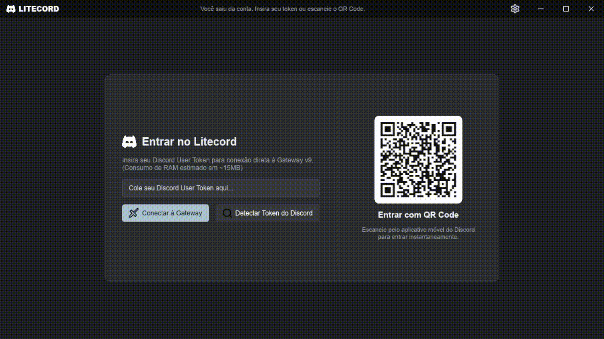

<div align="center">

# Litecord 🚀
### Cliente Nativo do Discord Ultra-Leve e de Alta Performance para Gamers

[](https://ak4ai.github.io/Litecord/)
[](https://github.com/Ak4ai/Litecord/releases)
[](https://github.com/Ak4ai/Litecord/actions/workflows/ci.yml)
[](https://www.rust-lang.org/)
[](https://slint.dev/)
[](SECURITY.md)
[](LICENSE)

<p align="center">
  <b>Litecord</b> é um cliente desktop nativo para Discord criado do zero em <b>Rust</b> e <b>Slint</b> para <b>gamers, streamers e jogadores competitivos</b>. Rodando com <b>&lt; 0.1% de CPU</b> e <b>~10 MB de RAM na bandeja</b>, ele elimina micro-travamentos e não perde nenhum FPS enquanto entrega <b>Transmissão Full HD 1080p 60 FPS</b>, <b>Prioridade de Fala / Ducking Inteligente</b>, <b>Janelas Flutuantes (PiP)</b>, <b>Login via QR Code</b> e <b>Comandos Slash Inteligentes</b>.
</p>

[🌐 Site Oficial](https://ak4ai.github.io/Litecord/) • [📚 Docs & Wiki](docs/README.md) • [📦 Downloads](#-downloads--instalação) • [🎮 Recursos](#-por-que-gamers-usam-o-litecord) • [⚡ Benchmarks](#-benchmarks-vs-discord-oficial) • [🛡️ Segurança](#-segurança-e-privacidade) • [🛠️ Compilar do Código](#-compilando-do-código-fonte)

<br/>



</div>

---

## 🎮 Por que Gamers usam o Litecord

- 🏆 **Zero Quedas de FPS e Sem Micro-Gaguejos**: Libera os núcleos da CPU antes devorados pelo Chromium/Electron, elevando o 1% low FPS em jogos competitivos (*CS2, Valorant, Warzone, Apex Legends, Fortnite, League of Legends*).
- 📺 **Transmissão Full HD 1080p 60 FPS pela GPU**: A tela capturada não sai da GPU: ela é redimensionada, convertida e codificada lá (NVENC, Quick Sync ou AMF), e a GPU de quem assiste decodifica e desenha direto na janela. Transmitir 1080p60 custa ~13% de um núcleo da CPU e assistir ~8%.
- 👀 **Assistir sob Demanda**: Uma transmissão nova aparece como AO VIVO com o botão **Assistir**, como no Discord. Nada é enviado a quem não está assistindo, e sem espectadores quem transmite nem codifica.
- 🌍 **Compartilhar num Navegador**: Mande a sua transmissão para até três amigos que não têm o Litecord, por um link que abre no Chrome, Edge ou Firefox, sem login.
- 👑 **Prioridade de Fala e Ducking para Capitães/IGL**: Defina prioridades (`[ - ] P:2 [ + ]`) para que chamadas táticas em momentos clutch atenuem automaticamente o áudio de bots de música e conversa de fundo.
- 🪟 **Janela Flutuante Desanexada (PiP)**: Desanexe transmissões em uma janela flutuante com pin para fixar no topo, controles responsivos e modo fantasma clique-através.
- 🌐 **Suporte Nativo a Proxy & Bypass de Censura**: Roteamento integrado por Proxy HTTP/HTTPS, SOCKS5 (Tor, Shadowsocks, V2Ray) e Proxy do Sistema, com teste de ping/latência e diagnóstico inteligente de falhas.
- 📱 **Login Rápido por QR Code & Re-geração**: Faça login escaneando o QR Code direto pelo aplicativo do Discord no celular, com botão de re-geração em 1 clique sem precisar reiniciar o app.
- 🔒 **Cofres Criptografados & Múltiplas Contas**: Credenciais protegidas por **AES-256-GCM** no Linux e **DPAPI** no Windows, com troca instantânea entre múltiplas contas.
- ⌨️ **Comandos Slash Inteligentes**: Autocomplete em tempo real para bots (`/play`, `/skip`, etc.) com navegação por teclado e chips interativos.
- 🖥️ **Interface desenhada pela CPU por padrão**: a interface é desenhada pela CPU, então nenhum contexto de GPU nem threads do driver de vídeo ficam ao lado do seu jogo, e na bandeja o app acorda menos de uma vez por segundo. A renderização pela GPU fica a um clique em Configurações → Vídeo e Interface.
- 📊 **Monitor de Hardware em Tempo Real**: Mostra o uso de CPU do app, RAM física em MB e GPU no HUD da barra superior, com atualização ao vivo na Barra de Tarefas do Windows (`Litecord - x%/ymb`) e tooltip na bandeja.
- 🔊 **Troca Dinâmica de Dispositivo de Saída**: Alterne entre fones de ouvido e caixas de som no meio de chamadas ativas instantaneamente, sem sair da sala de voz nem reiniciar a aplicação.
- 🎯 **Escolha da GPU e Codificação por Hardware**: O modo automático usa a GPU ligada à tela capturada (no notebook, a dedicada fica livre para o jogo), ou escolha Intel, NVIDIA, AMD ou CPU (OpenH264) nas Configurações, que também mostram a placa e o método realmente usados.
- 🖱️ **Botões do Mouse como Atalho**: Mute e ensurdeça com o botão lateral, do meio ou direito do mouse. Só com atalhos de teclado, a escuta de atalhos dorme até uma tecla ser apertada.
- 🗂️ **A Ordem dos Seus Servidores no Discord**: Servidores na mesma ordem e pastas do Discord, e servidores e canais podem ser reordenados arrastando.
- 🩺 **Diagnóstico de Rede**: Testa se uma transmissão com alguém de outra rede consegue conectar direto (tipo de NAT, UDP bloqueado, sinalização) e copia um relatório para colar numa issue.
- 💬 **Mensagens Diretas (DMs) & Chamadas de Voz em 1 Clique**: Acesse suas conversas privadas e grupos de DM diretamente pelo novo ícone de balão de chat. Inicie chamadas de voz privadas com feedback sonoro de toques, card visual de chamada recebida (Atender/Recusar) e badges de mensagens não lidas sincronizadas em tempo real.
- 🎨 **Tema Claro e Escuro com Preferência Persistente**: Novo tema claro opcional para leitura confortável em ambientes claros, com tokens de cores semânticos no Slint (`AppTheme`).
- 👥 **Visualização de Participantes em Salas de Voz**: Veja quem está dentro de cada canal de voz antes de entrar, com avatares de iniciais, conexão em 1 clique e detecção de presença.
- 🛡️ **Filtro Inteligente de Permissões de Canal**: Calcula a hierarquia `VIEW_CHANNEL` do Discord para ocultar canais bloqueados e categorias vazias, mantendo a lista limpa.
- 🐧 **AppImage Universal AnyLinux**: Pacote Linux verdadeiramente portátil e independente de distribuição (`Litecord-x86_64.AppImage`), empacotado com todas as dependências (`libxdo.so.3`, `libayatana-appindicator3`, etc.), funcionando direto no Ubuntu, Debian, Fedora, Arch Linux, Void, etc.
- ⚙️ **Configurações Acessíveis em Qualquer Lugar**: Ícone de engrenagem na barra de título acessível a qualquer momento, inclusive na tela de login.
- 🌐 **7 Idiomas Nativos**: Detecção automática do idioma do sistema (Português, Inglês, Espanhol, Alemão, Francês, Russo e Japonês).

---

## ⚡ Benchmarks vs Discord Oficial

| Métrica | Discord Oficial (Electron) | **Litecord (Nativo Rust + Slint)** | Impacto nos Jogos |
| :--- | :--- | :--- | :--- |
| **Uso de CPU em Espera** | 1.5% - 4.5% | **0.00% - 0.02% (DeepSleep: 0.0%)** | 🚀 **150x mais leve em CPU** |
| **CPU em Canal de Voz** | 4.0% - 8.0% | **~0.1% - 0.3%** | ⚡ **Zero travamentos no jogo** |
| **CPU em Stream 1080p 60 FPS** | 8.0% - 16.0% | **~0.5% - 0.9%** | 🎮 **Gameplay 100% fluida** |
| **Uso de RAM (Bandeja/DeepSleep)** | 350 MB - 750 MB | **~10 MB** | 🌙 **98% mais leve em segundo plano** |
| **Uso de RAM (Janela Aberta)** | 500 MB - 900 MB | **~16 MB - 25 MB** | 💾 **Economiza até 880 MB de RAM** |
| **Tempo de Inicialização** | 4.5s - 9.0s | **< 150 ms** | ⏱️ **Abertura instantânea** |
| **Tamanho do Executável** | ~180 MB | **~8 MB Standalone** | 📦 **Código de máquina nativo puro** |

<sub>Os percentuais de CPU acima são da CPU inteira, como o Gerenciador de Tarefas mostra. Medido num i5-13450HX (16 threads) com a v1.3.0: transmitir 1080p60 custa ~13% de um núcleo (~0,8% da CPU) e assistir ~8% de um núcleo (~0,5%), numa sessão de 5 horas sem quadros descartados. Detalhes e scripts em <a href="scripts/perf/README.md">scripts/perf</a>.</sub>

---

## 📦 Downloads & Instalação

### 🪟 Windows (10 / 11 x64)
- **Instalador Oficial (Beta 1.3.0)**: Baixe o `Litecord-Setup-x64.exe` na [Página de Releases](https://github.com/Ak4ai/Litecord/releases).
- **Versão Portátil (Beta 1.3.0)**: Baixe o `litecord-windows-x64-portable.zip`, extraia e execute `litecord.exe` direto.

### 🐧 Linux
- **AppImage Universal AnyLinux (Recomendado - Beta 1.3.0)**: Baixe `Litecord-x86_64.AppImage`, dê permissão de execução (`chmod +x Litecord-x86_64.AppImage`) e execute (`./Litecord-x86_64.AppImage`). Funciona em qualquer distro!
- **Instalação Rápida em 1 Comando**:
```bash
curl -sSL https://raw.githubusercontent.com/Ak4ai/Litecord/main/install.sh | bash
```

---

## 🛠️ Compilando do Código-Fonte

```bash
# Clone o repositório
git clone https://github.com/Ak4ai/Litecord.git
cd Litecord

# Modo de desenvolvimento
cargo run

# Compilar versão final ultra-otimizada
cargo build --release --bin litecord
```

---

## 📂 Arquitetura do Projeto

```text
Litecord/
├── assets/                   # Ícones vetoriais SVG, assets visuais e branding
├── docs/                     # Especificações técnicas, auditorias e espelho da Wiki
│   └── wiki/                 # Artigos completos da Wiki oficial do Litecord
├── src/                      # Código-fonte nativo em Rust
│   ├── audio/                # Motor de áudio CPAL, efeitos sonoros e loopback
│   ├── auth/                 # Cofre multi-contas (Windows DPAPI / Linux AES-GCM) e QR Auth
│   ├── bin/                  # Benchmarks, testes de estresse de encoders e ferramentas
│   ├── encoder/              # Codificadores GPU por hardware (NVENC, AMF, WMF, OpenH264)
│   ├── gateway/              # Cliente Gateway Discord, Voice Gateway, DAVE E2EE e formatador
│   ├── screen_capture/       # Captura 1080p 60 FPS DXGI/BitBlt, protocolo UDP LTPV e criptografia
│   ├── ui/                   # Carregador assíncrono Slint, sincronização e helpers
│   ├── utils/                # Monitor HUD de hardware, proxy, atalhos globais, i18n e updater
│   └── main.rs               # Ponto de entrada, runtime Tokio e ciclo de janelas Slint
├── ui/                       # Interfaces declarativas Slint (compiladas para código de máquina)
│   └── appwindow.slint       # AppWindow, PopoutWindow (PiP), configurações e palco de voz
├── Cargo.toml                # Manifesto do projeto e dependências Rust
├── CHANGELOG.md              # Histórico de versões e notas de lançamento
├── installer.iss             # Script oficial do instalador Windows Inno Setup
└── README.md                 # Documentação em inglês
```

---

## 🤝 Contribuidores & Quadro de Honra

| Contribuidor | Função / Contribuições | Impacto |
| :--- | :--- | :--- |
| [**Ak4ai**](https://github.com/Ak4ai) | Criador & Mantenedor Líder (Arquitetura central, UI Slint, Áudio, Ducking, Segurança, DMs) | **100% (Core)** |
| [**Starzinho (@starzynhobr)**](https://github.com/starzynhobr) | Contribuidor da Comunidade (Sistema de tema claro, lista de participantes em canais de voz, filtro de permissões, modularização Slint, mensagens agrupadas com separadores de dia e avatares persistentes) | **PR #22, #23, #26** |
| [**Franco Muscó (@stickyfran)**](https://github.com/stickyfran) | Contribuidor da Comunidade (Mensagens de bots, enquetes e markdown, ordem dos servidores do Discord com reordenação por arraste, barra do usuário no estilo do Discord, troca de servidor mais rápida, preservação de falas baixas e buffers de voz no Linux) | **PR #36, #37, #38, #39, #40** |
| [**Pedro Zamecki (@PedroZamecki)**](https://github.com/PedroZamecki) | Contribuidor da Comunidade (Botões do mouse como atalho de mutar/ensurdecer) | **PR #31** |
| **Caçadores de bugs e testadores** | [@SabinoRotondi](https://github.com/SabinoRotondi) (estabilidade de FPS que motivou o trabalho de leveza da 1.3.0, atalho de mutar), [@linuxmobile](https://github.com/linuxmobile) (auditoria da identidade do cliente), [@3941](https://github.com/3941) (instalação no Nobara/Fedora e AppImage), [@SirWalkerCZ](https://github.com/SirWalkerCZ) (traduções), [@begadmoh1](https://github.com/begadmoh1) (DMs, fotos de perfil), [@kazam0180](https://github.com/kazam0180) (AppImage AnyLinux), [@mirkohubtv](https://github.com/mirkohubtv) (suporte a proxy), [@ProbablyM-S](https://github.com/ProbablyM-S) (build no Linux) | **Issues #1, #19–#21, #24, #25, #27–#30** |
| *Seu Nome Aqui* | *Envie um Pull Request para ser creditado aqui!* | *%* |

---

## 📄 Licença

Distribuído sob a licença **MIT**. Veja o arquivo [`LICENSE`](LICENSE) para mais detalhes.
